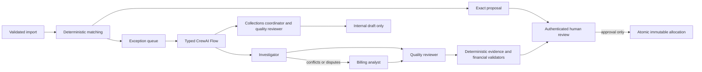

# CrewAI engineering
Pinned CrewAI 1.15.30, native OpenAI SDK 2.54.0, Pydantic 2.12.5; Python 3.12.
Official references reviewed 2026-10-26:
- https://docs.crewai.com/en/concepts/flows
- https://docs.crewai.com/en/concepts/agents
- https://docs.crewai.com/en/concepts/tasks
- https://docs.crewai.com/en/concepts/crews
- https://docs.crewai.com/en/concepts/tools
- https://docs.crewai.com/en/concepts/llms
- https://docs.crewai.com/en/learn/human-feedback-in-flows

## Collaboration and conditional routing
Investigator interprets references; dispute analyst challenges conflicts; quality reviewer
has previous tasks as explicit context and challenges their findings. Collections coordinator
and quality reviewer form a separate conditional crew for follow-up recommendations.
Simple exact matches bypass inference. Baseline records not_executed, never mock output.
Agents cannot delegate beyond the controlled composition. Each receives one genuine
BaseTool: a read-only, organisation-scoped, investigation-bounded evidence snapshot.
No shell, SQL, filesystem, arbitrary network, messaging or posting tools are exposed.

Flow[ReconciliationState] uses start/listen/router. Route labels differ from listener
method names, as enforced by the installed framework. Agent/task YAML specifies role,
goal, backstory and task policy; Python specifies shared execution limits (4 iterations,
1 agent retry, 180s agent budget; 1 guardrail retry). Task output_pydantic=Findings and
callable guardrail enforce schema, case identity, exact field/value citations, invoice
allowlists and contradictory allocation recommendations. Application allocation
validators independently check fresh financial truth before proposals are saved and
again at human approval. Agent quality review never substitutes for those checks.

## PostgreSQL checkpoints and recovery
Execution rows own job state, attempts, model/mode, stage, lease token, deadline, JSON
Flow state, results, usage and errors. No CrewAI SQLite persistence is authoritative.
Worker claims with FOR UPDATE SKIP LOCKED, commits, then loads evidence and closes
its transaction before inference. Parent process renews a 90s lease every 10s. A child
process bounds total runtime at 480s. Persisted callbacks/checkpoints use short sessions.
All writes verify lease token and running status. Expired jobs can be claimed up to
3 attempts. The final validated result is a checkpoint: resume skips completed inference.
Interrupted tasks before a result checkpoint may repeat read-only inference/tool calls;
completed ledger actions cannot repeat because workers never post allocations.
Crew callback objects are reconstructed from code; only typed state is persisted. Current
CrewAI warns that closure callbacks are not serialisable; this application does not use
Crew object serialisation or its separate checkpoint store.

## Providers and disclosure
MODEL_MODE=baseline (default), ollama, or explicitly enabled hosted.
Ollama uses its officially supported /v1 OpenAI-compatible endpoint via CrewAI native
OpenAI provider with a local-only placeholder key. LiteLLM was removed because its
current filelock<4 constraint blocks security fixes. References:
https://docs.ollama.com/api/openai-compatibility and CrewAI concepts/llms. Ollama URL is
restricted to local hostnames, model presence and advertised tools checked before work.
llama3.2:3b is installed locally (~2GB model); capability support is not evidence of
reconciliation accuracy. Timeout, malformed output and invalid citations fail explicitly.
Hosted mode requires HOSTED_ENABLED=true plus model/provider credentials; no hosted
requests were authorised here. Secrets never enter the settings API. Telemetry/tracing
exports are disabled; application audit/tool records provide local observability.
CrewAI import itself initialises standard per-user credential storage even with tracing
disabled. No CrewAI login or AMP service is required.

Token usage is stored only when returned by CrewAI. Local model cost is not fabricated;
estimated monetary cost remains unmeasured. Concise structured findings are persisted;
hidden chain-of-thought and raw model transcripts are not required or saved by the app.
