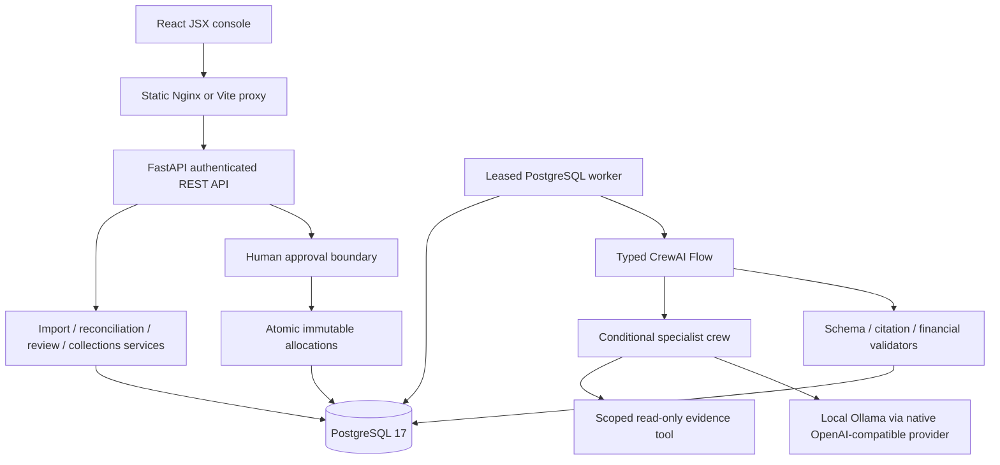
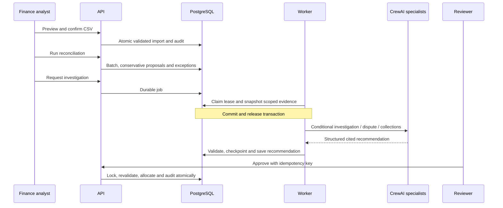
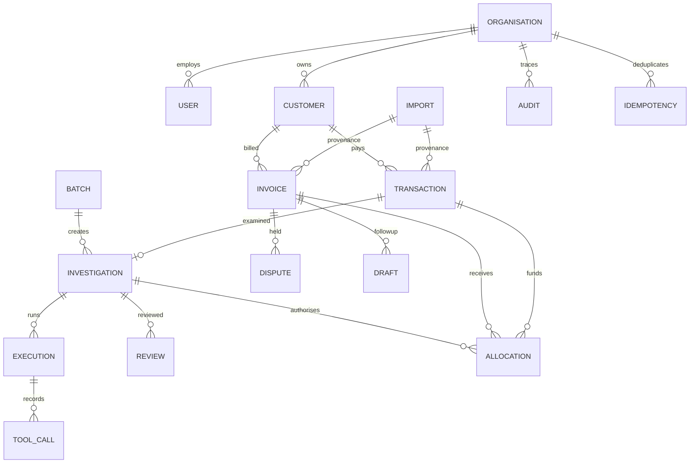

# System architecture

Services separate routes, request/output schemas, scoped repository access, Decimal
accounting, deterministic engine, evidence snapshots, provider configuration, CrewAI
definitions, Flows and durable workers. PostgreSQL owns business records and workflow
checkpoints. SQLite exists only in isolated unit/evaluation tests, never as business truth.
No DB transaction is held during model inference. The frontend can request actions but
cannot supply authoritative balances. No external messaging or banking integration exists.

Evidence references are typed structured output embedded in execution/proposal JSON;
crew/task composition is versioned YAML/Python and task outcomes are auditable events.
Normalisation is pragmatic: no redundant authoritative balance/status columns or separate
agent database. Organisations are scoped at the application boundary; PostgreSQL owner
credentials remain privileged and deployment must restrict direct access.
